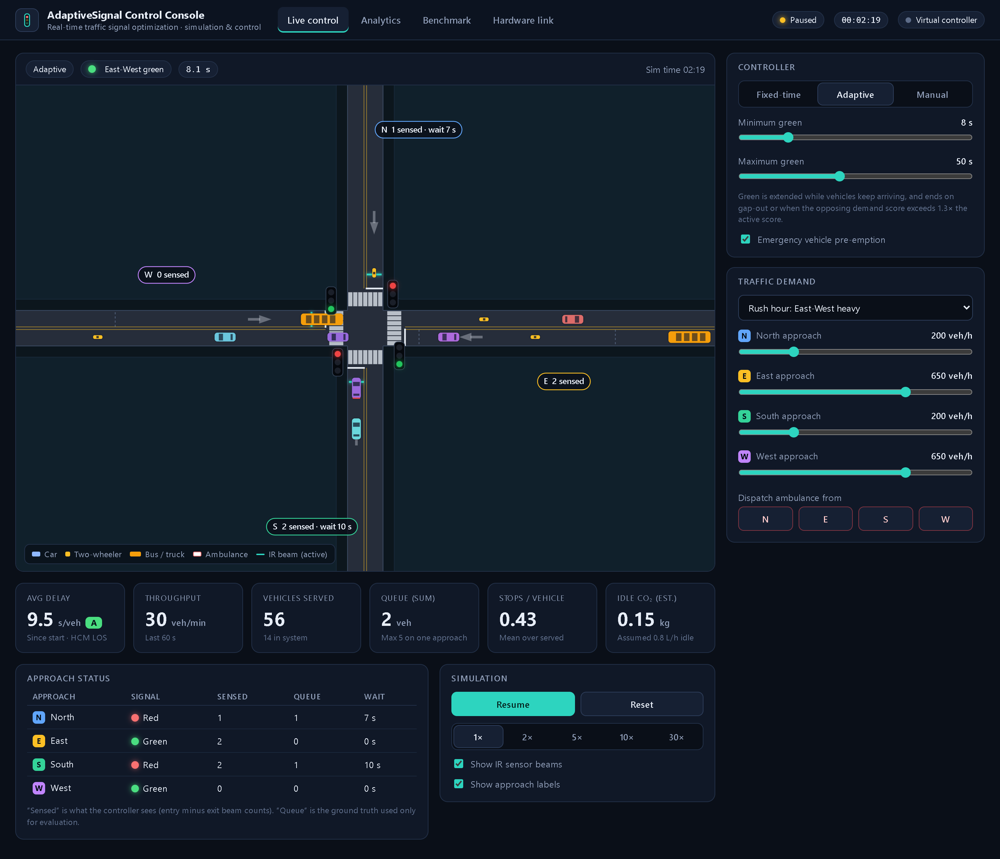
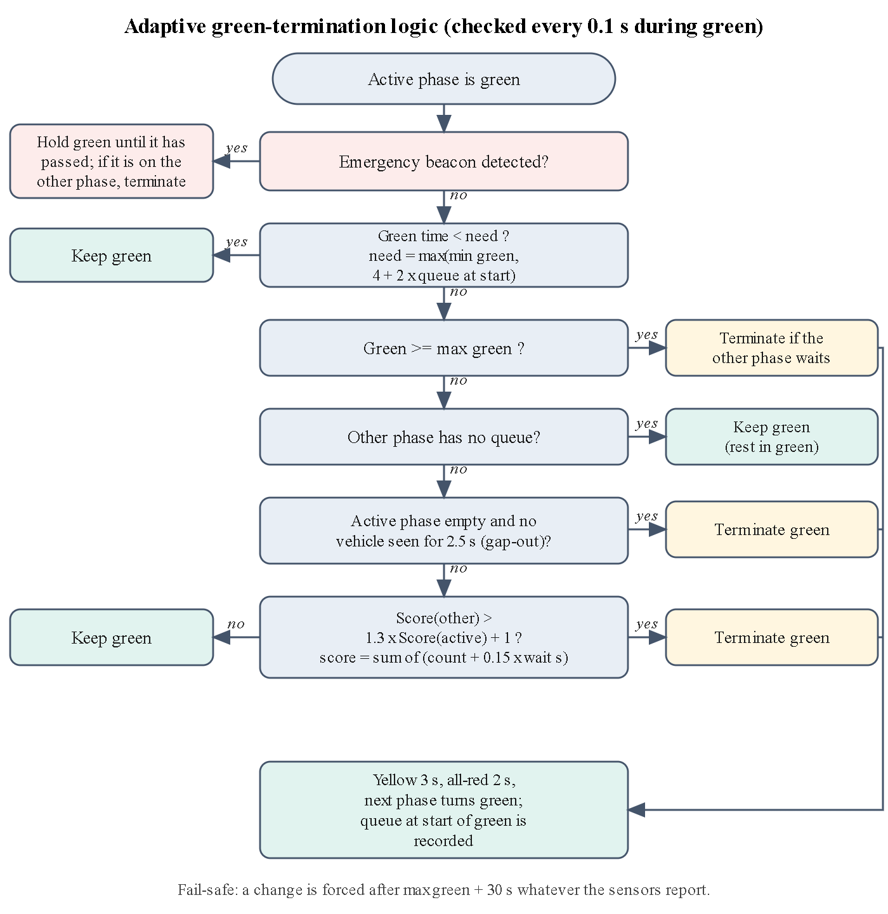
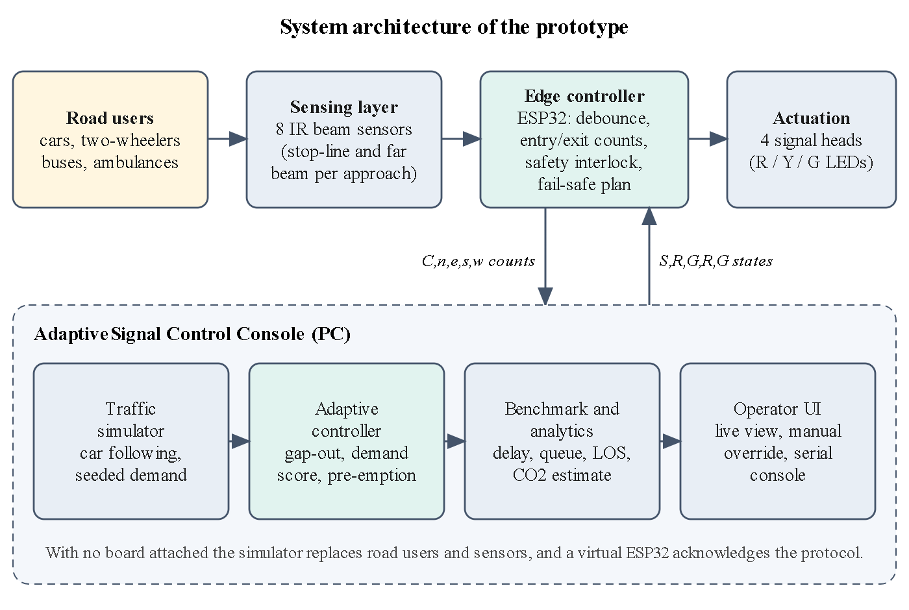
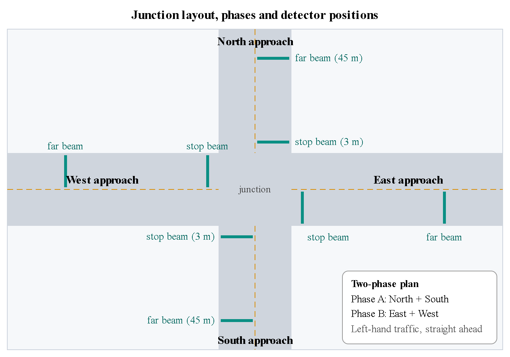

# Real-Time Traffic Signal Optimization

A low-cost, sensor-based **adaptive traffic signal controller** for an isolated four-way junction, with a browser **simulator and control console** and a reference **ESP32 firmware** sketch. The controller sees only what two cheap infrared beams per approach can measure (vehicles in minus vehicles out), shares green time according to that demand, gives ambulances priority and keeps fixed safety interlocks.

Built for the hardware junction model of a B.Tech Design Experience II project (NMIMS MPSTME). The software side (simulation, control logic, console, benchmark) lives here.



## Live demo

Deployed on Vercel: <ADD-YOUR-VERCEL-URL-HERE> (the console runs entirely in the browser; the serial link works over HTTPS in Chrome or Edge).

## Quick start

No install and no internet are needed.

1. Open `prototype/index.html` in Chrome or Edge (or double-click `DEMO.bat` on Windows).
2. Pick a scenario, switch between **Fixed-time**, **Adaptive** and **Manual**, dispatch an ambulance, open the **Analytics**, **Benchmark** and **Hardware link** tabs.

Command line (Node.js 18 or newer, no dependencies):

```bash
npm test             # 9 safety and verification tests
npm run benchmark    # 10 seeds x 7 scenarios x 3 controllers, writes scripts/results.json
```

## Features

* Microscopic simulation (Intelligent Driver Model) of cars, two-wheelers, buses and ambulances, left-hand traffic, seeded and repeatable
* Three controllers: fixed-time, Webster-tuned fixed-time (baseline), and the adaptive rule
* Sensor model identical to the hardware design: stop-line beam at 3 m and far beam at 45 m on each approach, entry/exit counts, self-correcting zone count
* Emergency-vehicle pre-emption, manual override with a 5 s interlock, fail-safe recall if sensors fail
* Live KPIs: delay with HCM level of service, throughput, queues, stops, idle CO2 estimate
* Benchmark tab and CLI with identical random traffic for every controller
* Serial link to an ESP32 (Web Serial API); a virtual board answers when no hardware is attached

## How the adaptive controller works



Only the end of green is decided by the controller. Yellow (3 s) and all-red (2 s) are fixed. The score of a phase is the sum over its approaches of *count + 0.15 x waiting seconds*; the controller switches when the other phase scores more than 1.3x the active one plus 1, after the queue present at the start of green has had time to discharge (4 s + 2 s per vehicle), on gap-out (2.5 s), or at the maximum green.

| Architecture | Junction and sensors |
|---|---|
|  |  |

## Results (simulation, mean of 10 random seeds, 30 simulated minutes)

Average delay in seconds per vehicle (lower is better):

| Scenario | Fixed 30/30 s | Webster-tuned fixed | Adaptive |
|---|---|---|---|
| Balanced (400 veh/h each) | 16.1 | 12.3 | **12.7** |
| Rush hour, East-West heavy | 25.2 | 11.6 | **12.4** |
| Asymmetric arrivals | 17.3 | 16.6 | **14.8** |
| Near saturation (650 each) | 31.3 | 33.9 | **30.5** |
| Night (90 each) | 12.2 | 7.1 | **4.4** |
| Time-varying demand | 20.1 | 20.6 | **10.5** |

Ambulances: mean delay 16.1 s with fixed-time, 5.3 s with adaptive control and pre-emption.

The adaptive controller beats the default 30/30 plan in every scenario and a Webster-tuned plan when demand is uneven or changing. In steady flow the Webster-tuned plan is slightly better, and near saturation capacity limits all three. These are simulation results for an idealised junction; hardware-in-the-loop tests are still to be done.

## Serial protocol (115200 baud, newline-terminated)

| Message | Direction | Meaning |
|---|---|---|
| `S,G,R,G,R` | console to board | signal states for N, E, S, W (R / Y / G) |
| `E,N` | console to board | emergency vehicle on approach N |
| `C,3,0,2,1` | board to console | vehicles inside each monitored zone, 1 Hz |
| `OK` / `ERR` | board to console | acknowledgement |

Reference firmware: [`prototype/firmware/traffic_controller/traffic_controller.ino`](prototype/firmware/traffic_controller/traffic_controller.ino). **It has not been compiled or flashed yet**; check the pin map against your wiring first. Reference hardware: ESP32-DevKitC, eight E18-D80NK-type IR beams, four three-LED signal heads (pin map in the console's Hardware link tab).

## Tests

`npm test` runs nine tests: no conflicting greens and intact clearance intervals over 270,000 simulated steps, repeatability from a seed, vehicle conservation, physical plausibility, sensing accuracy (ideal and with 5 % missed events), manual-override interlock, sensor-fault fail-safe, emergency pre-emption latency and serial-protocol grammar.

## Project layout

```
vercel.json           Vercel config (serves prototype/ as a static site, no build step)
prototype/            browser console, simulator and controllers (index.html, js/, css/), ESP32 firmware
scripts/              benchmark + sensitivity runs (analysis.js), test suite (tests.js), stored results
docs/                 screenshots and diagrams used in this README
DEMO.bat              Windows launcher: console, tests, benchmark
```

`prototype/js/sim.js` is a single module that runs unchanged in the browser and in Node.

## Assumptions and limits

* One lane per approach, straight-through movements only, two phases, no pedestrians
* Two-wheelers queue in single file; beams are ideal presence detectors with random misses
* Idle emissions assume 0.8 L/h per stopped vehicle and 2.3 kg CO2 per litre (indicative only)
* Not a certified traffic controller

## Author

Lokesh Magare, B.Tech Computer Engineering, NMIMS MPSTME Shirpur.

## License

MIT, see [LICENSE](LICENSE).
